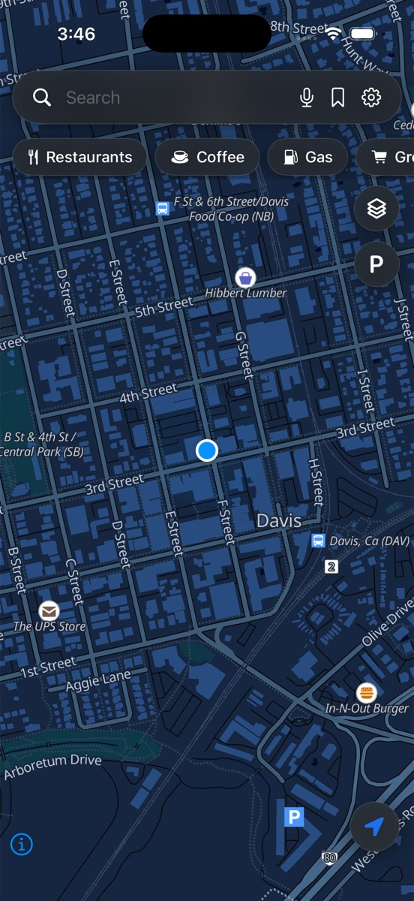
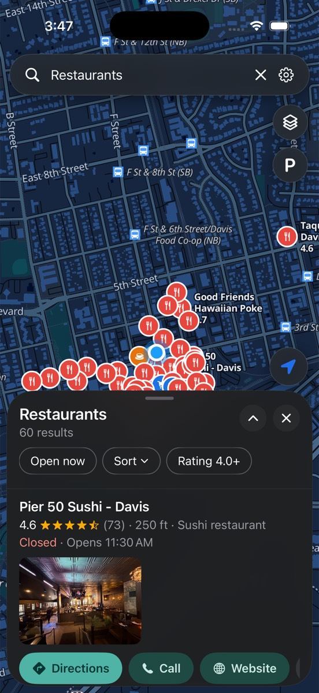
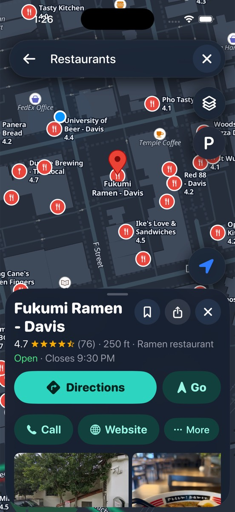
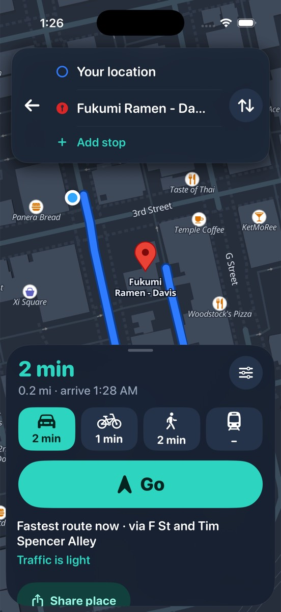
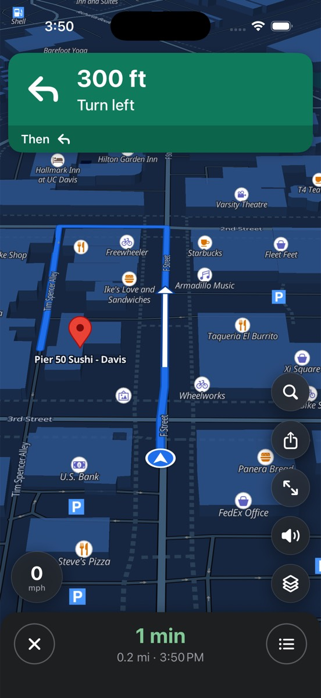
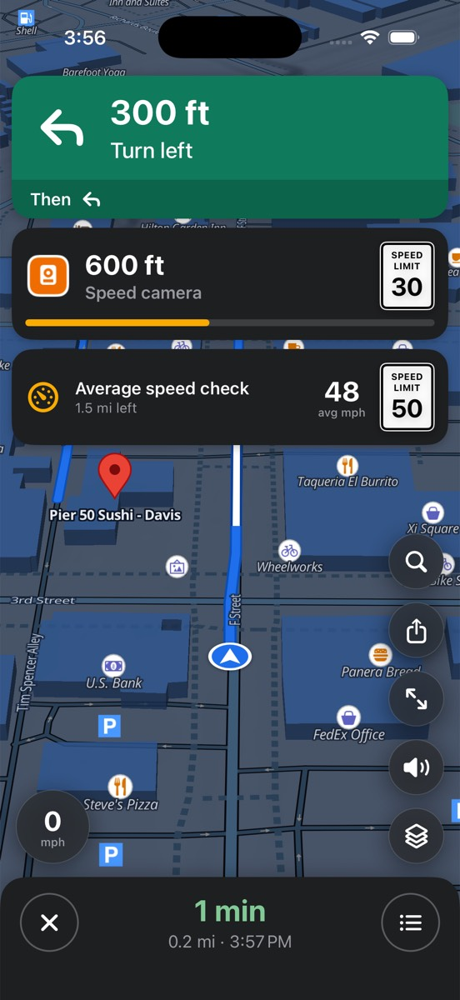
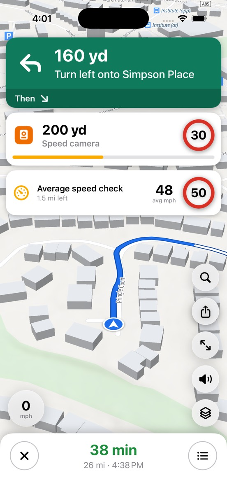
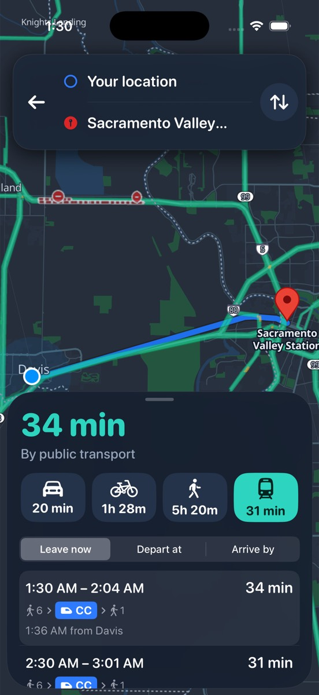
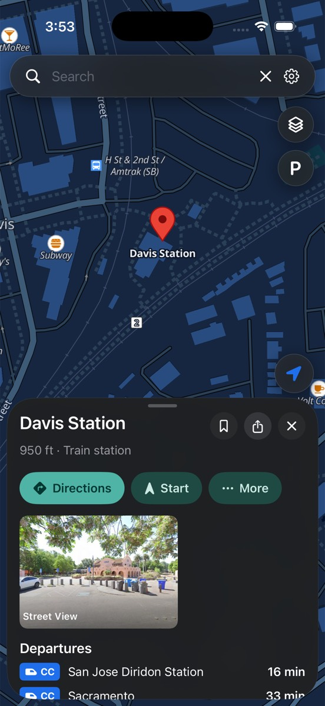
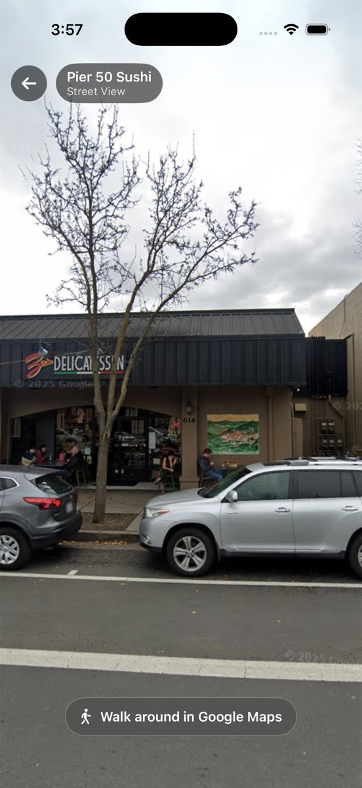

<div align="center">


# Kite Maps

**Private maps and turn-by-turn navigation for iPhone, with Google's search and traffic and no Google account.**

An unofficial iPhone port of [Vela Maps](https://github.com/PimpinPumpkin/Vela) for Android.

[](https://github.com/matteofx1/kite-maps/releases/latest)
[](https://github.com/matteofx1/kite-maps/actions/workflows/build.yml)
[](LICENSE)
[](#vibecoded-with-claude)


[Get the app](#get-the-app) · [What you get](#what-you-get) · [Screenshots](#screenshots) · [Privacy](#privacy) · [Vibecoded](#vibecoded-with-claude) · [Credits](#credits)

</div>

> [!note]
> **Kite is a hobby project in beta.** It's not on the App Store: you install it yourself
> (sideload). Expect bugs, and please [open an issue](https://github.com/matteofx1/kite-maps/issues)
> if you find one.

Kite brings [Vela Maps](https://velamaps.org/), the open-source Google Maps alternative for
Android, to the iPhone. The map itself is open data (OpenStreetMap, drawn with MapLibre).
When you search, tap a place or ask for directions, your phone asks Google's public web pages
directly, anonymously, the way a logged-out browser would. No account, no API key, no server in
between, and no Google code in the app. Don't want Google at all? Flip one switch and everything
comes from open data instead.

## Get the app

1. Open the [**latest release**](https://github.com/matteofx1/kite-maps/releases/latest) and
   download **`Kite.ipa`**.
2. Install it with [AltStore](https://altstore.io) or [Sideloadly](https://sideloadly.io) using
   your Apple ID. With a free Apple ID the app needs refreshing every 7 days (AltStore can do
   this for you).

### Get updates automatically (AltStore / SideStore)

Add this source once and Kite updates itself whenever a new build comes out:

```
https://raw.githubusercontent.com/MatteoFX1/kite-maps/altstore/apps.json
```

In AltStore or SideStore, open **Sources**, tap **+**, paste the link above, then install
**Kite Maps** from the source. If you already have Kite installed, it keeps your saved places.

Every change merged into `main` builds a new release automatically on a GitHub Actions Mac.
Pull requests build too: their `.ipa` is under the run's **Artifacts** in the Actions tab.

## What you get

- 🗺️ **A good-looking map**: navy at night, classic by day, on OpenFreeMap tiles. Live traffic
  and satellite from the layers button.
- 🔎 **Google search with no account**: suggestions as you type, category chips, ratings,
  open now, sort and filters. Falls back to OpenStreetMap if Google doesn't answer. Paste a
  Google Maps, Waze or Apple Maps link and it opens the place.
- 📍 **Place pages**: photos, rating, hours, phone, website, Street View (360°), save, rename and
  share. Press and hold anything to copy it. Tap the map to look up a spot, or long-press to
  drop a pin.
- 🚗 **Directions**: drive, bike, walk and public transit, with live traffic times, alternate
  routes, and avoid tolls or motorways.
- 🧭 **Turn-by-turn navigation** with voice, rerouting, arrival time and the speed limit, and
  it keeps going with the screen off.
- 🚦 **Waze-style driving help**: lane arrows, a roundabout picture with your exit, road signs,
  and speed camera warnings with a chime and a countdown bar. Average speed checks show your
  average against the limit.
- 📷 **Speed and number plate cameras** from OpenStreetMap on the map.
- 🚓 **Live Waze reports (beta)**: police, crashes, hazards, weather, roadworks and closures from Waze
  drivers, on the map and as warnings on your route, plus a police heat map. Pick which ones in
  **Settings → Waze integration**. Plus a police risk score for the road ahead and police aircraft alerts (from [adsb.lol](https://adsb.lol)), all worked out on your phone.
- 🚆 **Transit**: live departure boards at stops and stations, line colours and live delays, from
  [Transitous](https://transitous.org).
- 🇬🇧 **Great in the UK**: miles and yards, British signs, postcode search, and clockwise
  roundabouts for driving on the left.
- ⭐ **Your stuff stays on your phone**: home, work, parked car, recent places, stops on the way,
  voice search and Siri shortcuts ("Take me home with Kite").

## Screenshots

| Map | Search | Place | Directions | Navigation |
|:-:|:-:|:-:|:-:|:-:|
|  |  |  |  |  |

| Camera alerts | UK driving | Transit | Departure board | Street View |
|:-:|:-:|:-:|:-:|:-:|
|  |  |  |  |  |

*Taken automatically in the iPhone simulator on every build.*

## Privacy

| What you do | What reaches Google |
| --- | --- |
| Look around the map | **Nothing.** Tiles come from OpenFreeMap and OpenStreetMap |
| Search | **Your search text, anonymously**, like a logged-out browser |
| Tap a place | **An anonymous lookup of that place** for its hours, photos and reviews |
| Get directions | **Where the trip starts and ends, anonymously.** Turn-by-turn steps come from the open OSRM router |
| Waze reports (beta, only if you turn them on) | **The map area you're looking at, or your route, anonymously**, sent to Waze (owned by Google) |
| Your saved places, history and settings | **Nothing, ever.** No account, no tracking, no Kite server |

Turn on **Settings → Use Kite without Google** (or pick "Open data only" on first launch) and
nothing is sent to Google (or Waze) at all: search comes from OpenStreetMap and routes from the FOSSGIS
servers.

## Vibecoded with Claude

Full honesty: **I'm not a programmer.** Kite was vibecoded: I described what I wanted and
[Claude](https://claude.ai) (Anthropic's AI) wrote the code, the build setup and this page,
working from Vela's open-source code. I test the builds on my own iPhone while driving around
the UK.

That means the code hasn't been reviewed by an experienced iOS developer. It works well for me,
but treat it as a beta, and bug reports and pull requests are very welcome.

## Credits

- **[Vela Maps](https://github.com/PimpinPumpkin/Vela)** by
  [PimpinPumpkin](https://github.com/PimpinPumpkin) ([velamaps.org](https://velamaps.org/)).
  Kite is built on Vela's ideas, design and its keyless Google search, ported from Vela's
  Kotlin code. All the hard work of figuring that out is theirs. Kite is an unofficial port and
  isn't made or endorsed by Vela's developer. If you're on Android, use Vela!
- Map data © [OpenStreetMap](https://www.openstreetmap.org/copyright) contributors, tiles by
  [OpenFreeMap](https://openfreemap.org) and OpenMapTiles, drawn with [MapLibre](https://maplibre.org).
- Routing by [FOSSGIS OSRM](https://routing.openstreetmap.de), transit by
  [Transitous](https://transitous.org), search fallback by [Photon](https://photon.komoot.io),
  UK postcodes by [postcodes.io](https://postcodes.io), cameras from OpenStreetMap and
  [DeFlock](https://deflock.me), live reports from the [Waze](https://www.waze.com/live-map) live map, imagery © Esri.

Kite is not affiliated with or endorsed by Google, Waze or Apple.

## How it's built

- `App/` is the SwiftUI app with the [MapLibre](https://maplibre.org) map.
- `VelaCore/` is the search and routing code (Google extractor, OpenStreetMap and FOSSGIS
  fallbacks, route tracking), ported from Vela's Kotlin `:core` module.
  `swift run vela-probe pizza` runs a live search from a Mac.
- `project.yml` describes the Xcode project; [XcodeGen](https://github.com/yonaskolb/XcodeGen)
  turns it into `Kite.xcodeproj`. The GitHub Actions workflow builds the `.ipa` on a Mac runner,
  so you don't need a Mac to make a release.

## License

GPL-3.0, the same as Vela. See [LICENSE](LICENSE).
