<div align="center">


# Kite Maps

**Private maps and turn-by-turn navigation for iPhone and Android.<br>Google's search and traffic, no Google account.**

[](https://github.com/matteofx1/kite-maps/releases/latest)
[](https://github.com/matteofx1/kite-maps/actions/workflows/build.yml)
[](LICENSE)
[](#vibecoded-with-claude)


[](#-android)

[Get the app](#get-the-app) · [What you get](#what-you-get) · [Screenshots](#screenshots) · [What's new](CHANGELOG.md) · [Privacy](#privacy) · [Vibecoded](#vibecoded-with-claude) · [Credits](#credits)

</div>

> [!note]
> **Kite is a hobby project in beta.** It's not on the App Store or Google Play: you install it
> yourself (AltStore on iPhone, F-Droid on Android). Expect bugs, and please [open an issue](https://github.com/matteofx1/kite-maps/issues)
> if you find one.

Kite is an open-source Google Maps alternative for iPhone and Android, made for driving. The
same app, screen for screen and with the same version numbers, on both phones. The map itself is open data (OpenStreetMap, drawn with MapLibre).
When you search, tap a place or ask for directions, your phone asks Google's public web pages
directly, anonymously, the way a logged-out browser would. No account, no API key, no server in
between, and no Google code in the app. Don't want Google at all? Flip one switch and everything
comes from open data instead.

## Get the app

### 🍎 iPhone

**Easiest: AltStore or SideStore** (updates arrive by themselves). Add this source once:

```
https://raw.githubusercontent.com/MatteoFX1/kite-maps/altstore/apps.json
```

In AltStore or SideStore, open **Sources**, tap **+**, paste the link above, then install
**Kite Maps**. Updating keeps your saved places.

**Or by hand:** download **`Kite.ipa`** from the
[latest release](https://github.com/matteofx1/kite-maps/releases/latest) and install it with
[AltStore](https://altstore.io) or [Sideloadly](https://sideloadly.io) using your Apple ID.
With a free Apple ID the app needs refreshing every 7 days (AltStore can do this for you).
Needs iOS 16 or newer.

### 🤖 Android

**Easiest: F-Droid** (updates arrive like any other F-Droid app). Add Kite's repo once:

```
https://raw.githubusercontent.com/MatteoFX1/kite-maps/fdroid/repo
```

In F-Droid, open **Settings › Repositories**, tap **+**, paste the link above, then search for
**Kite Maps** and install.

**Or by hand:** download **`Kite.apk`** from the
[latest release](https://github.com/matteofx1/kite-maps/releases/latest).
Works without Google Play Services, so GrapheneOS and other de-Googled phones are fine.
Needs Android 8 or newer.

### New versions

Every change merged into `main` builds a new release for both phones automatically on GitHub
Actions, named after its version (like `v0.7.8`) with a "What's new" list from
[CHANGELOG.md](CHANGELOG.md).

## What you get

- 🗺️ **A clean, calm map**: a Waze-like look at night, classic by day, on OpenFreeMap tiles.
  While you drive it strips down to just roads and names. Live traffic and satellite from the
  layers button.
- 🚘 **Made for driving**: big buttons you can hit in a phone holder, a huge turn banner, a smooth
  3D car arrow, the road you're on under the arrow, and a bottom dock with Map, Saved and Settings.
- 🔎 **Google search with no account**: suggestions as you type, category chips, ratings,
  open now, sort and filters. Falls back to OpenStreetMap if Google doesn't answer. Paste a
  Google Maps, Waze or Apple Maps link and it opens the place.
- 📍 **Place pages**: photos, rating, hours, phone, website, Street View (360°), save, rename and
  share. Press and hold anything to copy it. Tap the map to look up a spot, or long-press to
  drop a pin.
- 🚗 **Directions**: drive, bike, walk and public transit, with live traffic times, alternate
  routes, and avoid tolls or motorways.
- 🧭 **Turn-by-turn navigation** with voice, rerouting, arrival time and the speed limit, and
  it keeps going with the screen off.
- 🚦 **Waze-style driving help**: lane arrows, a roundabout picture with your exit, road signs,
  and speed camera warnings with a chime and a countdown bar. Average speed checks show your
  average against the limit.
- 📷 **Speed and number plate cameras** from OpenStreetMap on the map.
- 🚓 **Live Waze reports (beta)**: police, crashes, hazards, weather, roadworks and closures from Waze
  drivers, on the map and as warnings on your route, plus a police heat map. Pick which ones in
  **Settings → Waze integration**. Plus a police risk score for the road ahead and police aircraft alerts (from [adsb.lol](https://adsb.lol)), all worked out on your phone.
- 🚆 **Transit**: live departure boards at stops and stations, line colours and live delays, from
  [Transitous](https://transitous.org).
- 🇬🇧 **Great in the UK**: miles and yards, British signs, postcode search, and clockwise
  roundabouts for driving on the left.
- ⭐ **Your stuff stays on your phone**: home, work, parked car, recent places, stops on the way,
  voice search, and on iPhone Siri shortcuts ("Take me home with Kite").

## Screenshots

### On iPhone

| Map | Search | Place | Directions | Navigation |
|:-:|:-:|:-:|:-:|:-:|
| 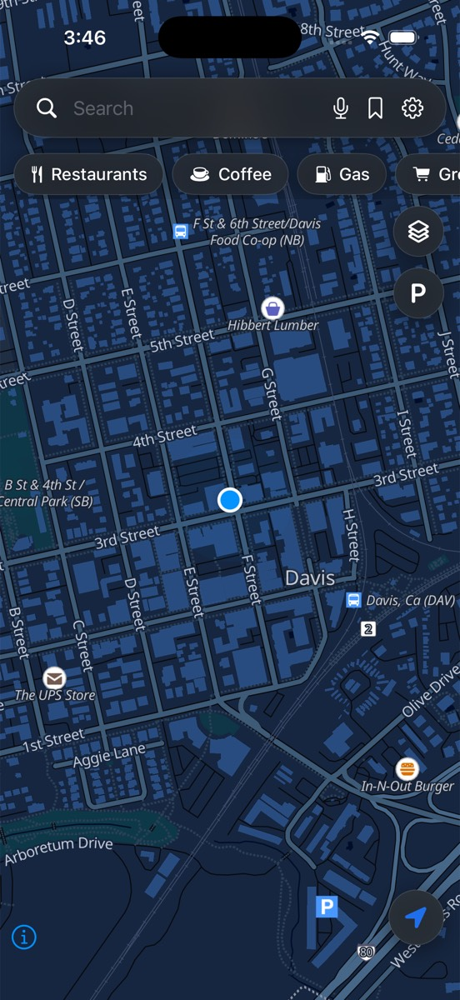 | 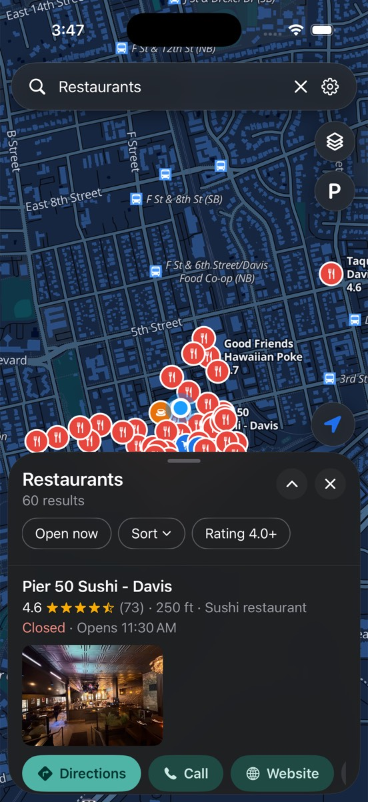 | 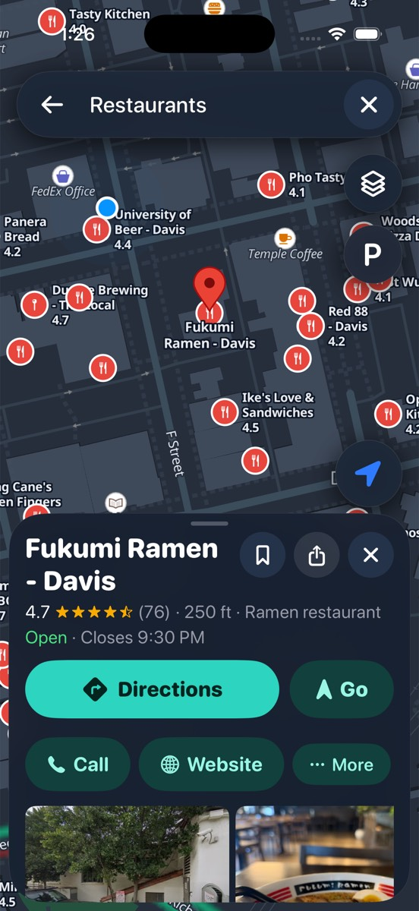 | 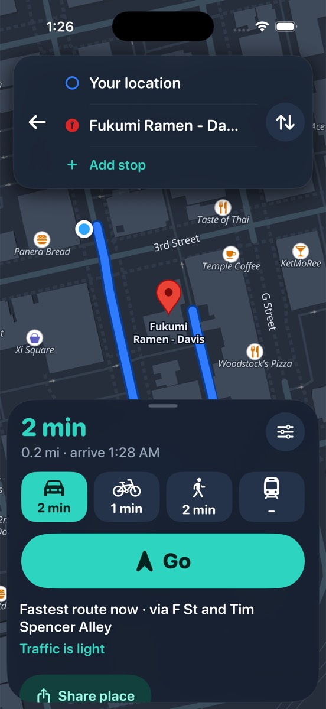 | 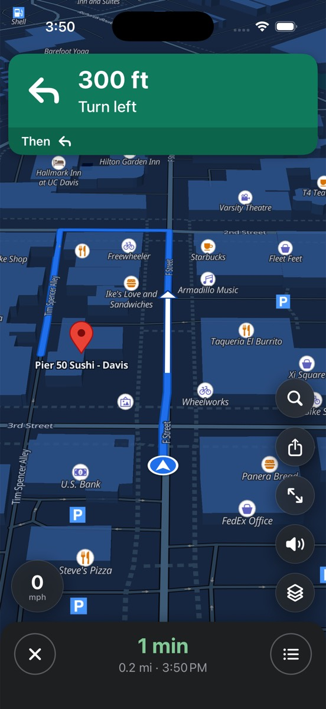 |

| Roundabouts | Camera alerts | Waze reports | Transit | Saved |
|:-:|:-:|:-:|:-:|:-:|
| 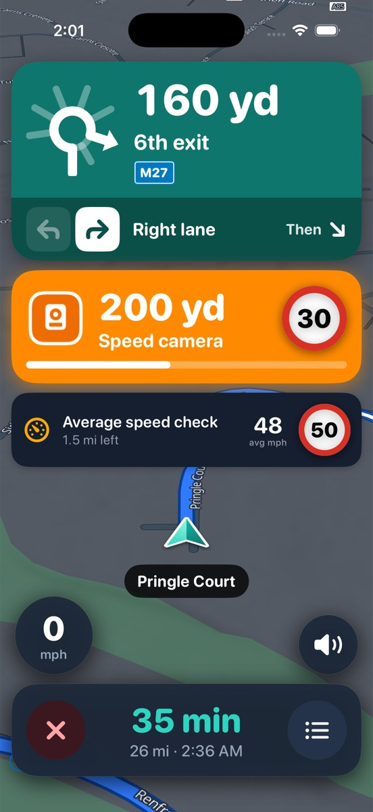 | 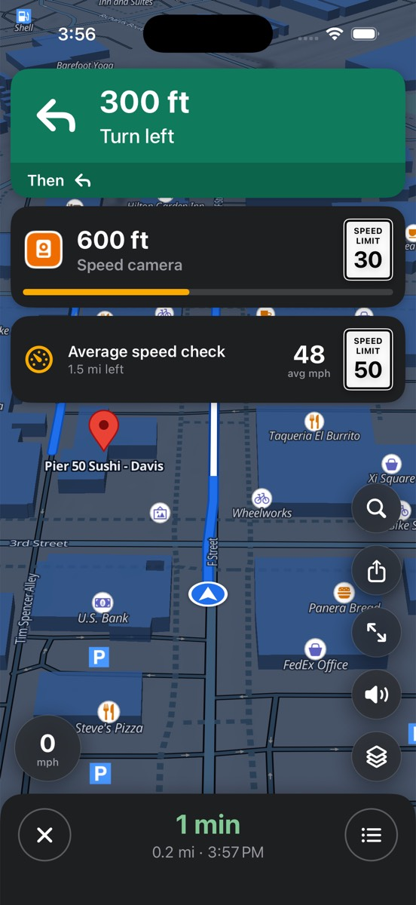 | 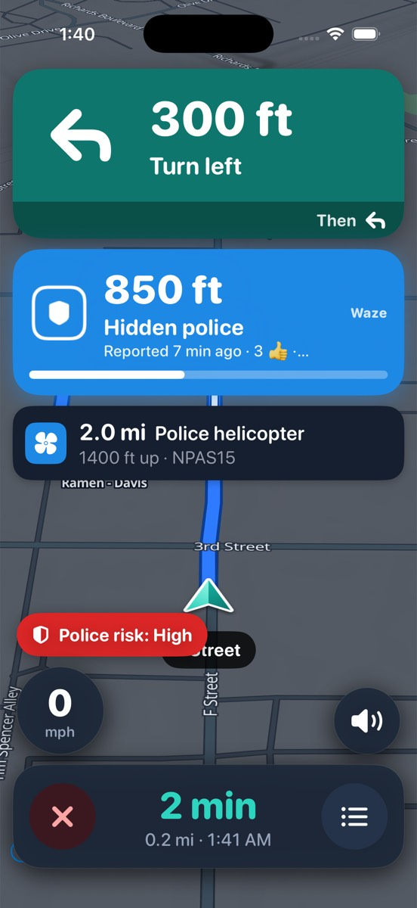 | 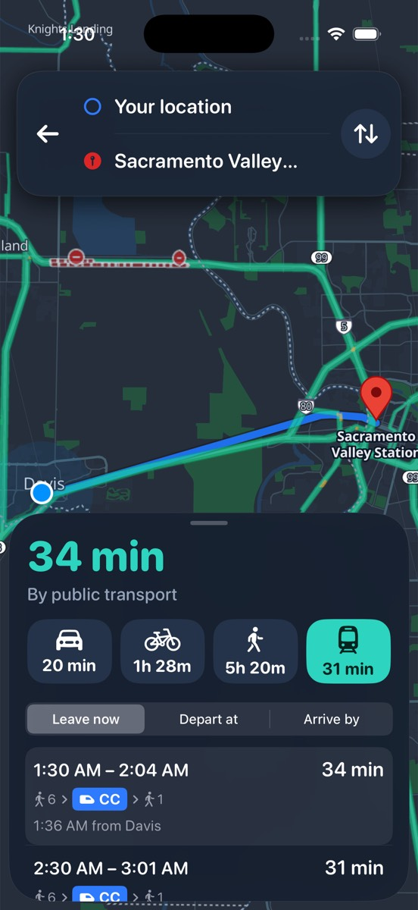 | 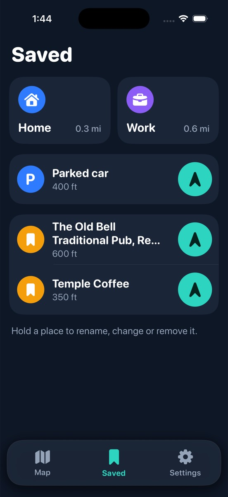 |

| Light mode | Big text | Departure board | Street View | Settings |
|:-:|:-:|:-:|:-:|:-:|
| 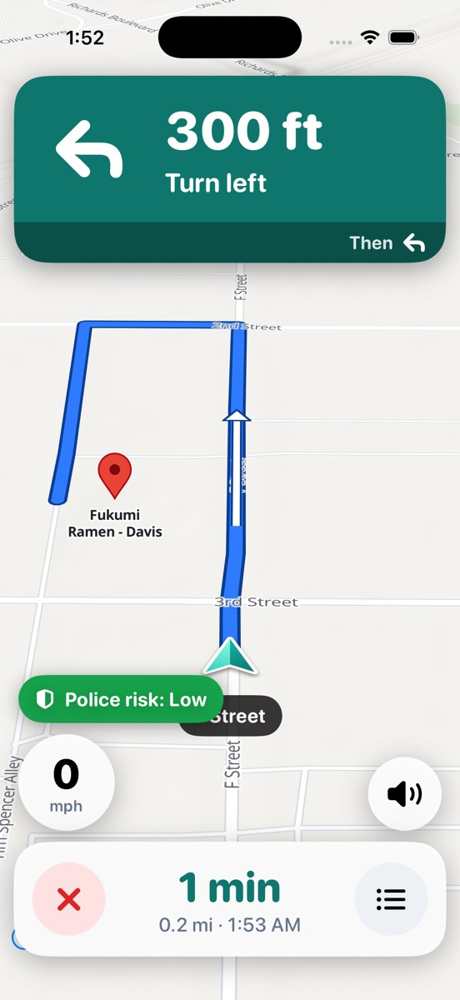 | 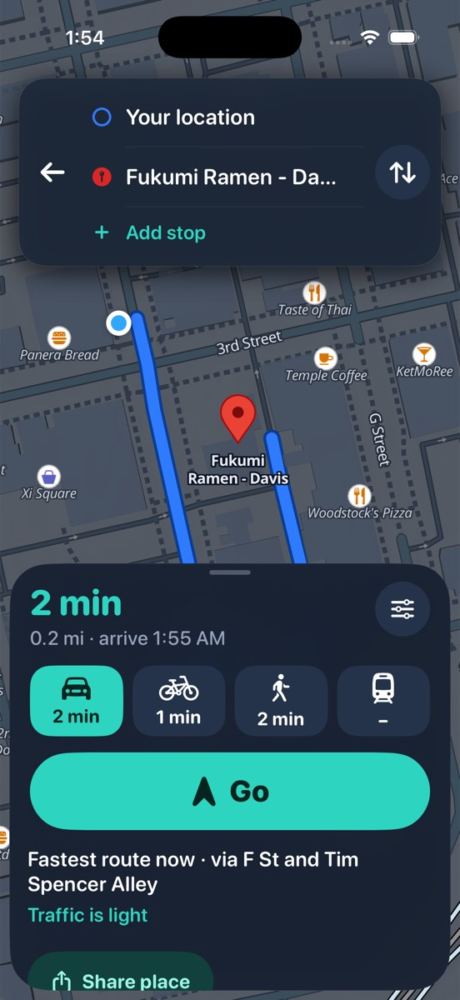 | 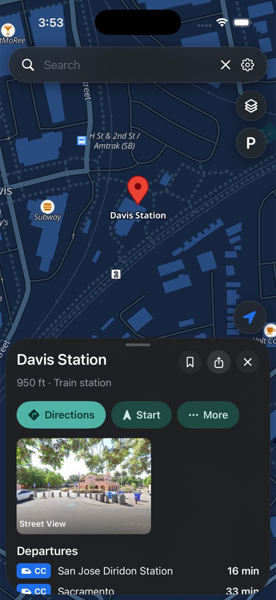 | 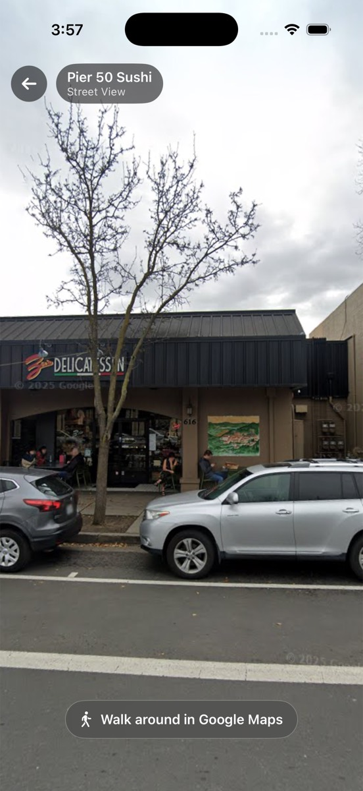 | 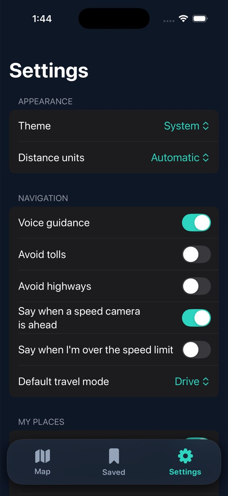 |

### On Android

| Place | Directions | Camera alerts | Night drive | Saved |
|:-:|:-:|:-:|:-:|:-:|
| 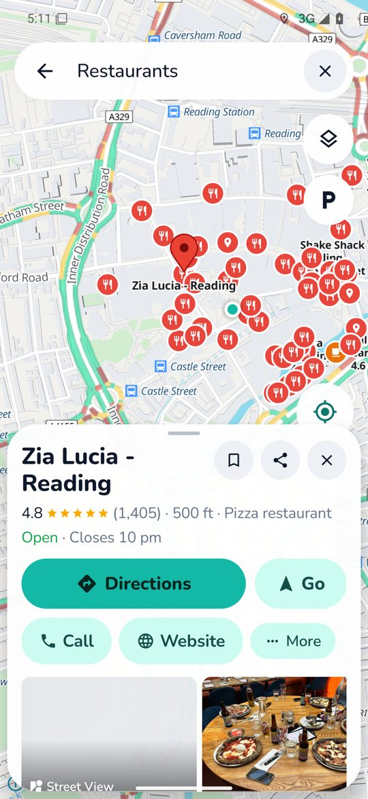 | 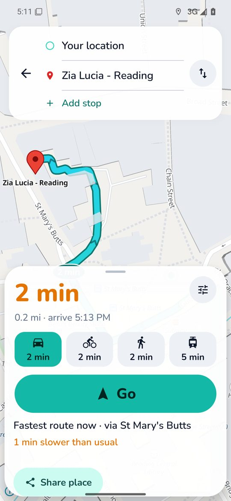 | 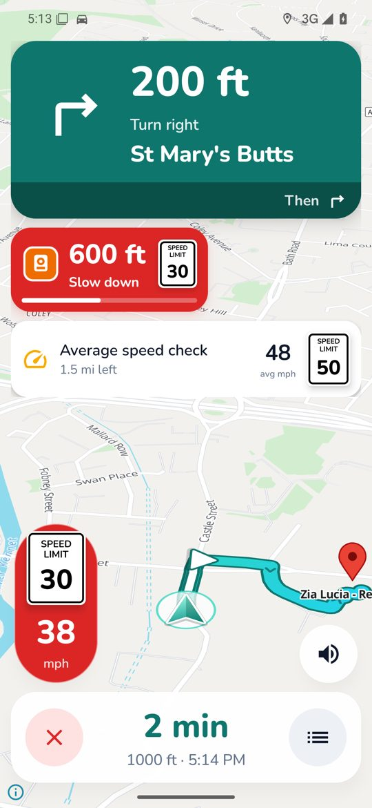 | 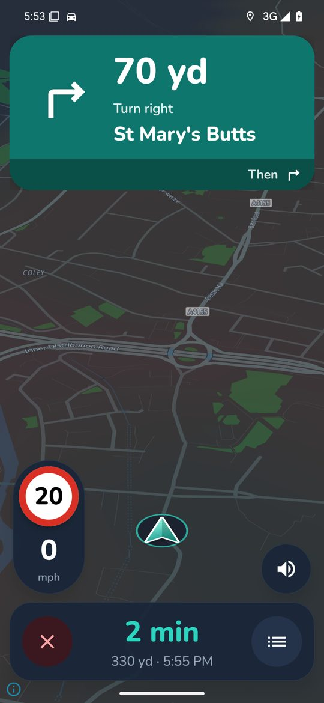 | 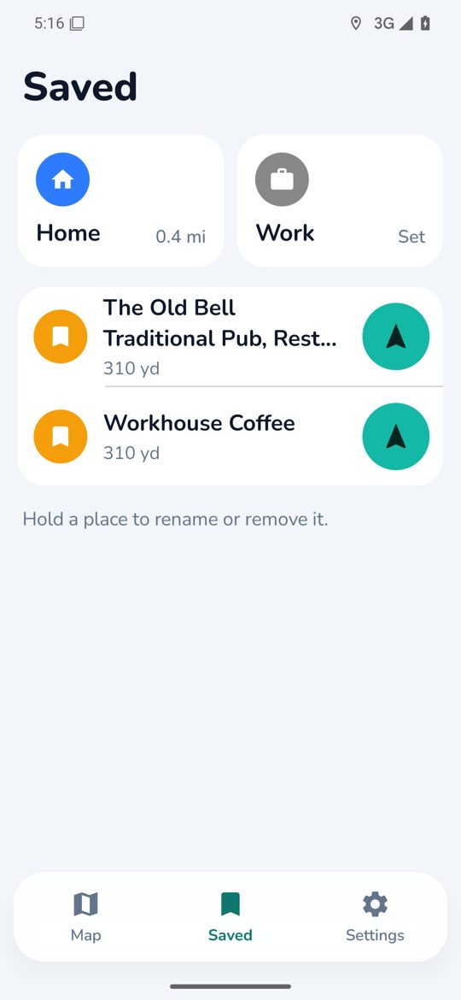 |

*Taken automatically in the iPhone simulator and the Android emulator.*

## Privacy

| What you do | What reaches Google |
| --- | --- |
| Look around the map | **Nothing.** Tiles come from OpenFreeMap and OpenStreetMap |
| Search | **Your search text, anonymously**, like a logged-out browser |
| Tap a place | **An anonymous lookup of that place** for its hours, photos and reviews |
| Get directions | **Where the trip starts and ends, anonymously.** Turn-by-turn steps come from the open OSRM router |
| Waze reports (beta, only if you turn them on) | **The map area you're looking at, or your route, anonymously**, sent to Waze (owned by Google) |
| Your saved places, history and settings | **Nothing, ever.** No account, no tracking, no Kite server |

Turn on **Settings → Use Kite without Google** (or pick "Open data only" on first launch) and
nothing is sent to Google (or Waze) at all: search comes from OpenStreetMap and routes from the FOSSGIS
servers.

## Vibecoded with Claude

Full honesty: **I'm not a programmer.** Kite was vibecoded: I described what I wanted and
[Claude](https://claude.ai) (Anthropic's AI) wrote the code, the build setup and this page,
starting from Vela's open-source code. I test it while driving around the UK.

That means the code hasn't been reviewed by an experienced iOS or Android developer. It works well for me,
but treat it as a beta, and bug reports and pull requests are very welcome.

## Credits

- **[Vela Maps](https://github.com/PimpinPumpkin/Vela)** by
  [PimpinPumpkin](https://github.com/PimpinPumpkin) ([velamaps.org](https://velamaps.org/)).
  Kite started from Vela and still uses its code (under GPLv3), including the keyless Google
  search, which was all their hard work. Kite isn't made or endorsed by Vela's developer.
- Map data © [OpenStreetMap](https://www.openstreetmap.org/copyright) contributors, tiles by
  [OpenFreeMap](https://openfreemap.org) and OpenMapTiles, drawn with [MapLibre](https://maplibre.org).
- Routing by [FOSSGIS OSRM](https://routing.openstreetmap.de), transit by
  [Transitous](https://transitous.org), search fallback by [Photon](https://photon.komoot.io),
  UK postcodes by [postcodes.io](https://postcodes.io), cameras from OpenStreetMap and
  [DeFlock](https://deflock.me), live reports from the [Waze](https://www.waze.com/live-map) live map, imagery © Esri.

Kite is not affiliated with or endorsed by Google, Waze or Apple.

## How it's built

- `App/` is the iPhone app (SwiftUI) with the [MapLibre](https://maplibre.org) map.
- `VelaCore/` is the iPhone's search and routing code (Google extractor, OpenStreetMap and
  FOSSGIS fallbacks, route tracking), first ported from Vela's Kotlin `:core` module.
  `swift run vela-probe pizza` runs a live search from a Mac.
- `project.yml` describes the Xcode project; [XcodeGen](https://github.com/yonaskolb/XcodeGen)
  turns it into `Kite.xcodeproj`. The GitHub Actions workflow builds the `.ipa` on a Mac runner,
  so you don't need a Mac to make a release.
- `android/` is the Android app (Kotlin, Jetpack Compose and MapLibre): `android/core` is the
  search and routing code, `android/app` is the app. It's built on GitHub Actions too, and
  published to Kite's own F-Droid repo.

## License

GPL-3.0, the same as Vela (Kite uses Vela's code, so it stays GPL). See [LICENSE](LICENSE).
